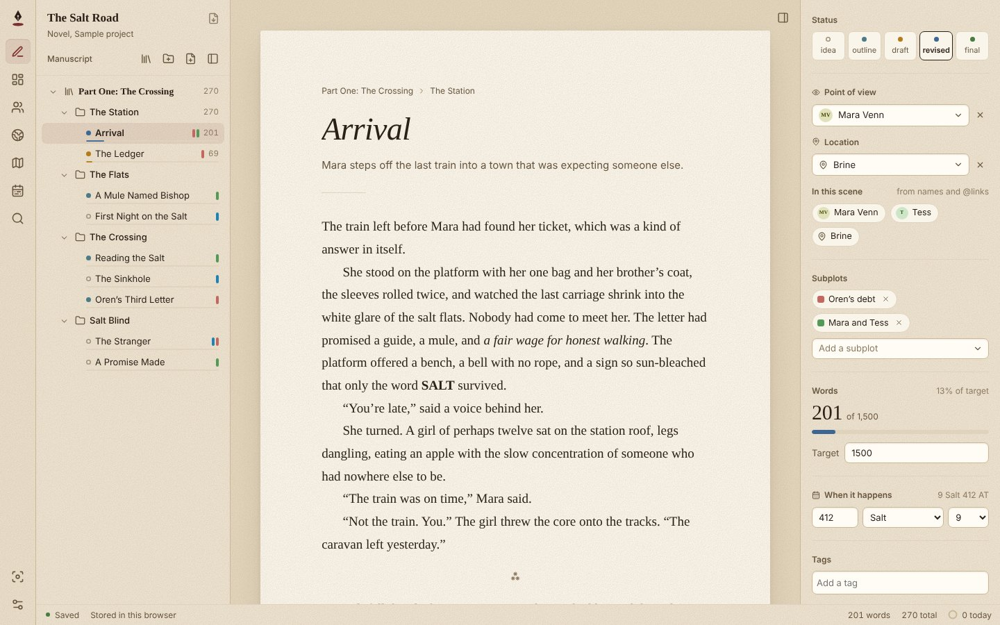
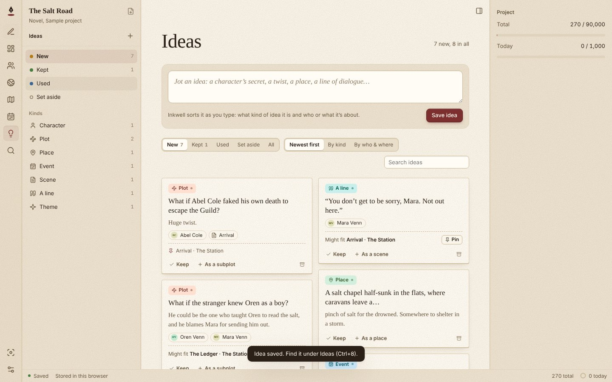
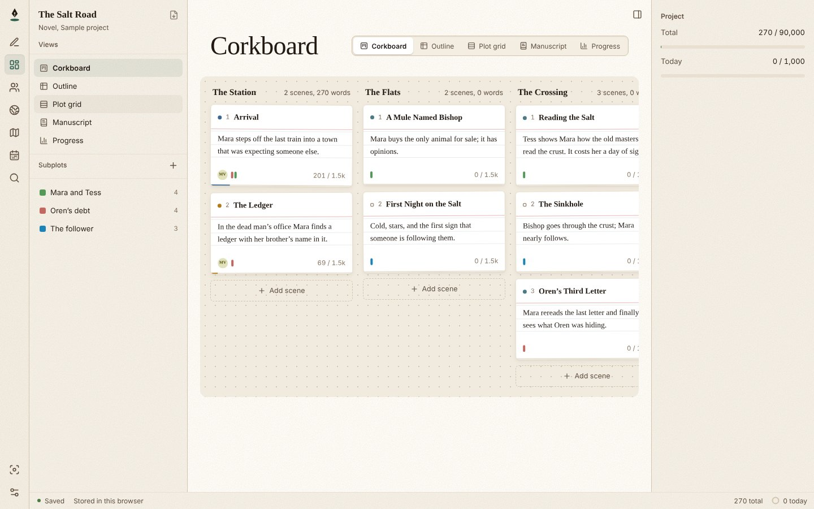
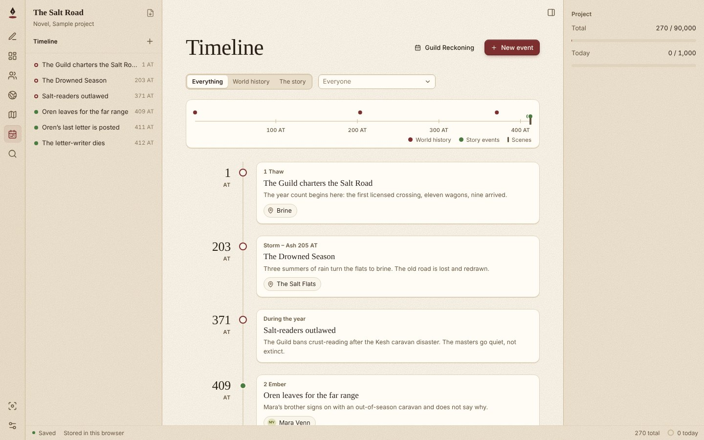
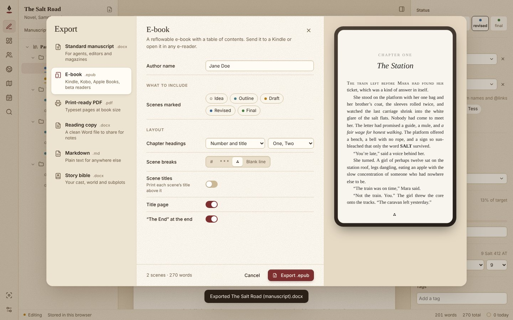

# Inkwell

**A free, open-source writing studio for novels and short stories.** Write in scenes, keep your
characters, world, subplots, maps and timeline in one place, and export a standard manuscript,
an e-book or a print-ready PDF. It runs on Windows, macOS and Linux.

Your work is never locked in. Every project is a plain folder of Markdown files, one per scene,
character or idea. Put it in Google Drive, Dropbox, OneDrive, iCloud or Syncthing and that
becomes your sync. There is no account and no server.



| | |
| --- | --- |
|  |  |
|  |  |

> Inkwell is young. It is being used to write a real novel, but expect rough edges, and keep
> backups of anything precious (the files are plain text, so that part is easy). Bug reports and
> ideas are very welcome in [Issues](https://github.com/smadgulkar/inkwell-writer/issues).

## Highlights

- **Scenes, chapters and parts** in a drag-and-drop binder, with a distraction-free editor, focus mode and typewriter scrolling
- **Characters and world-building:** profiles, arcs, relationships and a relationship map; places, cultures, religions, magic systems and more; type `@` to link them in your prose
- **Planning:** corkboard, outline, plot grid of subplots against scenes, and the whole manuscript as one document
- **Maps** from any image, with pins and character journeys; **timeline** with your own calendar
- **Ideas inbox** that sorts your notes by kind and by who and where they are about, and suggests the scene they fit
- **Snapshots** of every scene, word-by-word comparison and restore; **sync conflict** handling for Dropbox, Drive, OneDrive and Syncthing
- **Export:** standard manuscript .docx, EPUB, print-ready PDF, Markdown and a story bible, all built in
- **Short story mode** with a submission tracker that warns you about simultaneous-submission rules and word limits
- **Warm, readable themes:** Study (default), Daylight, Dusk and Night, and six writing typefaces

## Get it

Installers will appear on the [Releases](https://github.com/smadgulkar/inkwell-writer/releases) page.
Until then, run it from source (below). It also runs in a browser (Chrome or Edge can save
straight to a folder on your computer).

## Features in detail

### Writing

- Novels (parts, chapters, scenes) and short stories, switchable any time
- Binder with drag-and-drop reordering, nesting rules, inline rename (double-click or F2), context menu, keyboard navigation
- Distraction-free editor: bold/italic/strike, scene breaks (`***` + Enter, or Ctrl/Cmd+Enter), smart quotes and em dashes, clean paste
- Scene title and synopsis on the page; chapter and part overviews with scene cards and notes
- Inspector: status, word target with progress, tags, dates, short-story length bands, chapter progress by status
- Split a scene at the cursor; delete moves files to `.inkwell/trash/`
- Command palette (Ctrl/Cmd+K) with fuzzy search over scenes and commands
- Focus mode, typewriter scrolling, four warm themes (Study, the default: laid paper on an oatmeal desk with an oxblood accent; Daylight, the lightest; Dusk and Night for evenings) plus Auto, six prose faces (Literata, Newsreader, Source Serif, EB Garamond, Instrument Sans, Courier Prime), size and line width
- Autosave 600 ms after typing stops; words today, project goal, daily goal
- Storage: a real folder (desktop app, or Chrome/Edge via the File System Access API) or browser storage, with "Save to a folder" to move a browser project out

### Characters and world

- Characters section: profile fields you can rename, add and remove; aliases; role; an arc (start, turning points linked to scenes, end); relationships; biography
- Relationship map on the characters overview, laid out automatically
- World section: places, cultures, religions, magic systems, technology, history, species, items, languages; nesting (a town inside a region); rules, costs and limits for magic and technology; pronunciation
- Type `@` in any editor to link a character or place, or create a new character on the spot; Ctrl/Cmd+click a link to open it
- "Appears in" on every character and world page, from links, POV/location and plain mentions of names and aliases
- Scene inspector: point of view, location, and everyone present in the scene
- Full-text search across scenes, notes, profiles and world entries (Ctrl/Cmd+Shift+S)
- Back and forward navigation (Alt+Left / Alt+Right); Ctrl/Cmd+1 to 8 switch sections (pressing a section's key again returns to its overview)

### Planning and subplots

- Plan section (Ctrl/Cmd+2) with four views:
  - **Corkboard:** index cards in a column per chapter; drag to reorder or move between chapters; edit synopses on the card
  - **Outline:** a table of every scene with inline title, synopsis, status, point of view, location and subplots; sort by title, status or words
  - **Plot grid:** subplots down the side, scenes across; click a cell to add a subplot to a scene, click again to note what happens; a line joins each thread's appearances
  - **Manuscript:** the whole book (or one chapter) as one continuous, editable document; scenes load as you scroll
- Subplots with a color, status (setting up, rising, resolved, dropped), characters involved, a summary and a scene-by-scene thread with notes
- Warnings when a subplot has not appeared for 5 or more chapters, or is not in any scene
- Subplot colors show in the binder, on index cards and in the scene inspector

### Maps and images

- Maps from any image (drop it in, or pick a file); pan, zoom, pinch, fit
- Pins linked to places or characters, dragged into position; "Add a map here" to nest a city map inside a region
- Journeys: a character's route across pins, each stop tied to a scene, drawn in that character's color
- Image galleries on characters and world entries; a character's first image becomes their portrait everywhere

### Time and history

- **Timeline** (Ctrl/Cmd+6): world history and story events on one line, plus every scene you give a date; a to-scale ruler, filters for world/story and by character, and an "undated" tray
- Your own calendar: month names and lengths, an era label ("412 AT")
- **Snapshots:** a copy of each scene is kept automatically on the first edit of the day; take named ones (Ctrl/Cmd+Alt+S); compare any snapshot with the current text word by word and restore it
- **Trash** you can open and restore from
- **Progress** (Plan > Progress): words today, streak, pace to a deadline, 30-day chart, chapter lengths, scenes by status, goals

### Export and submissions

Export (Ctrl/Cmd+Shift+E, or the icon by the project title) with a live preview of the first page:

- **Standard manuscript (.docx):** Courier or Times 12 pt, double spaced, contact block, rounded word count, title a third of the way down, `Surname / TITLE / page` header, `#` scene breaks, END
- **E-book (.epub):** EPUB 3 with a table of contents (and an EPUB 2 NCX for older readers)
- **Print-ready PDF:** typeset book pages at 6×9 in, A5 or Letter, through the system print dialog
- **Reading copy (.docx)** and **Markdown**
- **Story bible:** characters, world and subplots as one Word, PDF or Markdown reference
- Include scenes by status, leave out tags, chapter heading style (One / 1 / I), scene separator, scene titles, title page, end mark; choose one story from a collection. Settings are saved in `project.yaml`.

All formats are generated inside the app; nothing extra (such as Pandoc) needs installing.

Submission tracker (short story mode, Ctrl/Cmd+7):

- Markets with pay rate, word limits, usual reply time and whether they take simultaneous submissions
- A log of every submission: market, story, date sent, status, reply date, payment, notes
- Warnings: resubmitting to a market that already passed, breaking a no-simultaneous rule (either way round), over or under a word limit, overdue replies
- Out now, total sent, acceptance rate and average reply time

### Reliability

- **Sync conflicts:** copies left by Dropbox ("conflicted copy"), Google Drive ("(1)"), OneDrive ("-PCNAME") and Syncthing (".sync-conflict-…") are detected when a project opens or while it is open. Identical copies are tidied away; different ones get a word-by-word comparison with Keep mine / Use the other / Keep both. The version you don't keep is saved in Snapshots.
- **Changes from other devices** are picked up when the window regains focus and every 20 seconds. If you were editing the same document at that moment, your typing is kept and the other version is offered as a conflict.
- Error boundaries: a failure in one view shows a message and saves your work instead of blanking the window
- Performance gates: `tests/perf.test.ts` opens, counts and exports a 157,000-word novel (about 180 ms to open, about 100 ms for the .docx on a laptop-class CPU); `npm run check:size` fails the build if the first load exceeds 250 KB gzipped (currently about 188 KB)
- Installers: `.github/workflows/release.yml` builds Windows (.msi, .exe), macOS (universal .dmg) and Linux (.deb, .rpm, .AppImage) packages on GitHub when you push a tag such as `v0.7.0`, and attaches them to a draft release. `ci.yml` runs the tests and size check on every push.

### Ideas

- **Ideas** (Ctrl/Cmd+8) is an inbox for loose notes: a character's secret, a twist, a place, an event, a scene you can half see, a line of dialogue
- **Jot one down from anywhere** with Ctrl/Cmd+J. If a character, place, subplot or scene is open, the idea is filed as being about it
- **Sorted as you type, offline:** the kind of idea (character, plot, place, worldbuilding, event, scene, a line, theme) and who or what it's about, from names, aliases and first names in the text. Click the kind to change it; a kind you pick stays put
- **Where it fits:** suggests the scenes it belongs in (where those people already appear, the subplot it touches, a similar synopsis), with a reason; pin it with one click
- **Views:** newest first, by kind, or by who and where; filter by New, Kept, Used, Set aside; search
- **Use it:** turn an idea into a scene (placed at its pin), character, place, world entry, timeline event or subplot, or add it to an existing character's notes. The idea is marked used and the new document links back to it
- Ideas also appear in the inspector of the character, place, subplot or scene they're about, with a button to jot another
- **Optional Claude assistant:** add your own Anthropic API key in Settings for a deeper read: kind, links, best scene, and up to three questions to develop the idea. Only the idea and the project's names and scene titles are sent; the key stays on your device. Everything else works without it
- Each idea is a Markdown file in `ideas/`

## Run it

```bash
npm install
npm run dev        # browser version with live reload at http://localhost:5173
npm test           # unit tests (Markdown round-trip fuzzing, binder rules, project loading)
npm run build      # production build into dist/
```

### Desktop app (Windows, macOS, Linux)

Needs Rust (https://rustup.rs) and the Tauri prerequisites for your OS
(https://tauri.app/start/prerequisites/).

```bash
npm run desktop:dev       # run the desktop app
npm run desktop:build     # build installers for this machine
```

Icons for every platform are already in `src-tauri/icons/`. If you update from an older
version and the build complains about permissions or plugins, delete `src-tauri/gen/` and run
again; Tauri regenerates it.

The desktop app reads and writes files with its own small Rust commands (`src-tauri/src/lib.rs`),
so it works in any folder you choose, including paths with spaces and synced folders.

### Releasing

```bash
git tag v0.7.0 && git push --tags   # GitHub builds installers for all three systems
```

Unsigned builds work, but Windows SmartScreen and macOS Gatekeeper will warn on first launch.
To sign, add your certificates as repository secrets (see the tauri-action docs). Auto-update is
not switched on yet; it needs an update signing key, which only you should hold.

## Project format

```text
The Salt Road.inkwell/
  project.yaml          # title, mode, goals, binder order
  manuscript/
    sc_k3f9a2qx.md      # one file per scene, named by permanent id
    ch_8hd02mzp.md      # chapters and parts are files too (title + notes)
  characters/cr_*.md    # one file per character
  world/wl_*.md         # one file per world entry
  subplots/sp_*.md      # one file per subplot; scenes list their subplots and beat notes
  maps/mp_*.md          # map image, size, pins and journeys
  timeline/ev_*.md      # dated events (world history or story)
  submissions/sb_*.md   # one file per submission (short story mode)
  submissions/mk_*.md   # one file per market
  ideas/id_*.md         # one file per idea
  assets/               # images: maps, portraits, galleries
  .inkwell/trash/       # deleted items
  .inkwell/snapshots/<id>/<timestamp>.md   # earlier versions of each document
  .inkwell/stats.json   # words written per day
```

Scenes are Markdown with YAML frontmatter. Unknown frontmatter keys are preserved, so you can
add your own fields. Files are named by id, never by title, so renaming never touches the
filesystem or causes sync conflicts.

## Code map

```text
src/model/     types, ids, frontmatter, markdown <-> blocks, binder, project load/save, maps,
               calendar, timeline, diff, submissions
src/export/    compile, zip, docx, epub + print HTML, markdown, story bible (no dependencies)
src/fs/        storage adapters: memory, browser storage, folder (File System Access), Tauri
src/store/     app state, autosave, editing actions, snapshots, sync conflicts
src/ui/        React components (Shell, Binder, Page, ProseEditor, Inspector, Palette, Settings,
               plan/, maps/, timeline/, export/, submissions/)
tests/         unit tests, including performance gates
scripts/       check-size.mjs (bundle budget)
src-tauri/     desktop shell
.github/       CI and release workflows
```

## Roadmap

- Signed installers and auto-update
- A final product name ("Inkwell" is a working title)
- Your suggestions: open an issue

## Contributing

Pull requests are welcome. Please run `npm test` and `npm run build` first; `npm run ci` runs
both plus the bundle size check. The code map above shows where things live. For bigger
changes, open an issue to talk it through before you start.

## License

[GPL-3.0-or-later](LICENSE). You are free to use, study, share and change Inkwell. If you
distribute a modified version, you must share its source under the same license.
